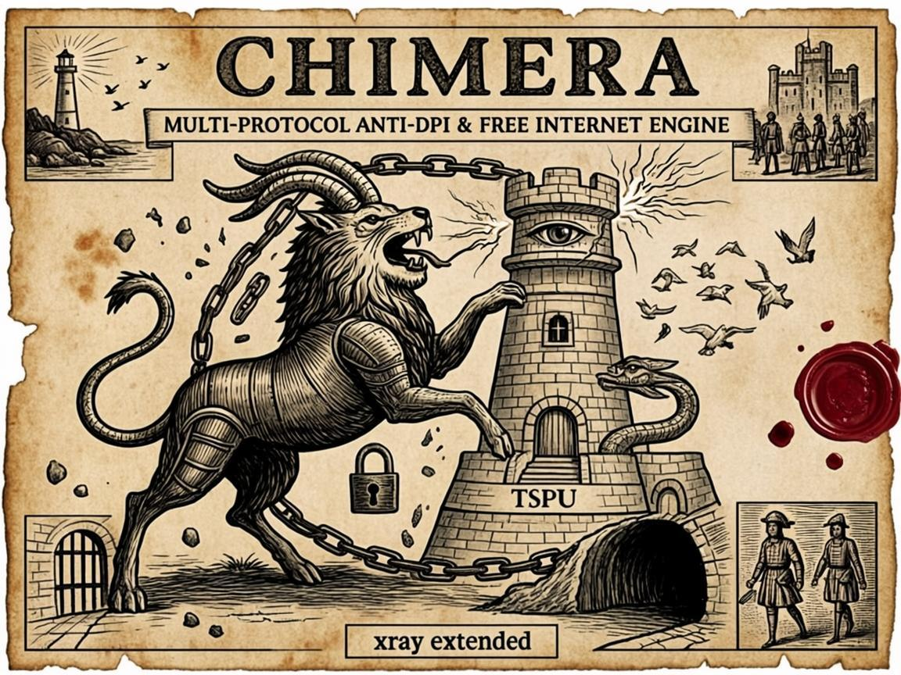

<div align="center">

# Chimera Project

[](https://git.chimeraprodvpn.online/inferno1978/chimera)
[](https://python.org)
[](https://git.chimeraprodvpn.online/inferno1978/chimera/src/branch/main/LICENSE)
[](https://ubuntu.com)



</div>

> 🎨 **Эмблема проекта.** Геральдическая химера рвёт кольцо цепей, а молния её львиной головы рушит башню всевидящего ока с клеймом «ТСПУ» — столько голов, сколько нужно: каждый протокол держит свой путь к свободному интернету. По углам медальона: маяк со свободными птицами — «Mare Liberum», свободное море как цель проекта; врата под три стука — port knocking; туннель под решёткой — туннельные транспорты сквозь блокады; маска, проходящая мимо ока — маскировка REALITY. Файл: [`assets/chimera_poster.png`](assets/chimera_poster.png).

**Multi-Protocol Anti-DPI Installer** — мульти-протокольный установщик для обхода цензуры: VLESS REALITY/xHTTP, Hysteria2, AmneziaWG, TrustTunnel, MTProto, NaiveProxy, Mieru, FPTN, Slipgate и др. Полная автоматизация: от установки до мониторинга, с кластеризацией, балансировкой, веб-панелью и REST API.

> **Почему Chimera?** Проект вырос из простого VLESS-installer в мульти-протокольный комбайн: 9+ протоколов, 143 модуля, 25 категорий — как мифическая химера, собранная из частей разных животных. Каждая «голова» (протокол) нужна для своего сценария: VLESS — основной, AmneziaWG — устойчивый к DPI, Hysteria2 — быстрый UDP, TrustTunnel — AdGuard VPN protocol, и т.д. Если цензор блокирует один протокол, химера «выращивает новую голову». Подробное обоснование — в CHANGELOG  

```
 ██████╗██╗  ██╗██╗███╗   ███╗███████╗██████╗  █████╗
██╔════╝██║  ██║██║████╗ ████║██╔════╝██╔══██╗██╔══██╗
██║     ███████║██║██╔████╔██║█████╗  ██████╔╝███████║
██║     ██╔══██║██║██║╚██╔╝██║██╔══╝  ██╔══██╗██╔══██║
╚██████╗██║  ██║██║██║ ╚═╝ ██║███████╗██║  ██║██║  ██║
 ╚═════╝╚═╝  ╚═╝╚═╝╚═╝     ╚═╝╚══════╝╚═╝  ╚═╝╚═╝  ╚═╝
 Chimera Project  — Multi-Protocol Anti-DPI Installer
```

## ⚡ Быстрый старт

**Безопасная установка** — bootstrap скачивается во временный файл, проверяется подпись Ed25519 (публичный ключ закреплён в самой команде) и только потом запускается. Зеркала с авто-fallback: Forgejo → GitLab → GitHub. Скопируйте и вставьте весь блок целиком:

```bash
# >>> CHIMERA SECURE INSTALL (канонический блок; проверяется tests/test_secure_bootstrap.py)
# Никакой bootstrap не исполняется до успешной проверки подписи Ed25519.
# Требования: bash, curl, mktemp, openssl >= 3.0 (проверяется ДО загрузки).
# Отладка: CHIMERA_INSTALL_DEBUG=1 — показывать ход установки на stderr.
chimera_install() (
    set -euo pipefail
    CHIMERA_PUBKEY='-----BEGIN PUBLIC KEY-----
MCowBQYDK2VwAyEA+6KSAskfo+LBzW/io8q376wAULspfGTik674H1o8Gu4=
-----END PUBLIC KEY-----'
    CHIMERA_MIRRORS=(
        "https://git.chimeraprodvpn.online/inferno1978/chimera/raw/branch/main/bootstrap.sh"
        "https://gitlab.com/netwalker071778/chimera-project/-/raw/chimera-v5/bootstrap.sh"
        "https://raw.githubusercontent.com/inferno1978/Chimera-Project/main/bootstrap.sh"
    )
    MAX_SIZE=524288  # 512 KiB — разумный потолок размера bootstrap

    dbg() { # печатает строку на stderr только при CHIMERA_INSTALL_DEBUG=1
        if [ "${CHIMERA_INSTALL_DEBUG:-0}" = "1" ]; then echo "[chimera-install] $*" >&2; fi
        return 0
    }
    fetch() { # fetch <url> <max-time> <outfile>; в debug-режиме stderr curl не глушится
        if [ "${CHIMERA_INSTALL_DEBUG:-0}" = "1" ]; then
            curl -fsSL --connect-timeout 10 --max-time "$2" "$1" -o "$3"
        else
            curl -fsSL --connect-timeout 10 --max-time "$2" "$1" -o "$3" 2>/dev/null
        fi
    }
    ed25519_verify_supported() { # функциональная проба openssl ДО загрузки: keygen -> sign -> verify
        openssl genpkey -algorithm ed25519 -out "$d/probe.key" >/dev/null 2>&1 || return 1
        printf 'x' > "$d/probe.in"
        openssl pkeyutl -sign -inkey "$d/probe.key" -rawin -in "$d/probe.in" -out "$d/probe.sig" >/dev/null 2>&1 || return 1
        openssl pkey -in "$d/probe.key" -pubout -out "$d/probe.pub" >/dev/null 2>&1 || return 1
        openssl pkeyutl -verify -pubin -inkey "$d/probe.pub" -rawin -in "$d/probe.in" -sigfile "$d/probe.sig" >/dev/null 2>&1 || return 1
        return 0
    }

    command -v openssl >/dev/null 2>&1 || {
        echo "ОШИБКА: не найден openssl — проверка подписи невозможна, установка прервана (см. docs/faq/BOOTSTRAP_SECURITY.md)." >&2
        exit 1
    }
    d="$(mktemp -d /tmp/chimera-bootstrap.XXXXXXXX)"   # каталог с правами 700; всё скачанное — только здесь
    tmp="$d/bootstrap.sh"
    sig="$d/bootstrap.sh.sig"
    pub="$d/pinned.pub"
    trap 'rm -rf "$d"' EXIT
    trap 'rm -rf "$d"; exit 130' INT TERM HUP
    printf '%s\n' "$CHIMERA_PUBKEY" > "$pub"
    chmod 600 "$pub"

    openssl pkey -pubin -in "$pub" -noout >/dev/null 2>&1 || {
        echo "ОШИБКА: не удалось разобрать закреплённый Ed25519-ключ (блок повреждён при вставке или openssl слишком старый) — установка прервана (см. docs/faq/BOOTSTRAP_SECURITY.md)." >&2
        exit 1
    }
    ed25519_verify_supported || {
        echo "ОШИБКА: openssl не поддерживает проверку подписи Ed25519 в raw-режиме — требуется OpenSSL >= 3.0 (сейчас: $(openssl version 2>/dev/null || echo 'версия не определена'); в FIPS-сборках Ed25519 может быть отключён). Установка прервана (см. docs/faq/BOOTSTRAP_SECURITY.md)." >&2
        exit 1
    }

    n_dl=0; n_bad=0; reasons=""
    for url in "${CHIMERA_MIRRORS[@]}"; do
        dbg "Пробую зеркало: $url"
        rm -f "$tmp" "$sig"
        if ! fetch "$url" 60 "$tmp"; then
            n_dl=$((n_dl+1)); reasons="${reasons}
  - недоступно (сеть/HTTP): ${url}"
            dbg "Отклонено (недоступно): $url"
            continue
        fi
        chmod 600 "$tmp"   # не полагаемся на umask
        size="$(wc -c < "$tmp")"
        if [ "$size" -eq 0 ] || [ "$size" -gt "$MAX_SIZE" ]; then
            n_bad=$((n_bad+1)); reasons="${reasons}
  - подозрительный размер файла (${size} байт): ${url}"
            dbg "Отклонено (размер ${size} байт): $url"
            continue
        fi
        if ! fetch "${url}.sig" 30 "$sig"; then
            n_bad=$((n_bad+1)); reasons="${reasons}
  - не удалось скачать подпись: ${url}.sig"
            dbg "Отклонено (нет подписи): ${url}.sig"
            continue
        fi
        chmod 600 "$sig"   # не полагаемся на umask
        if [ "$(wc -c < "$sig")" -ne 64 ]; then
            n_bad=$((n_bad+1)); reasons="${reasons}
  - повреждённая подпись (не 64 байта): ${url}"
            dbg "Отклонено (подпись не 64 байта): $url"
            continue
        fi
        if openssl pkeyutl -verify -pubin -inkey "$pub" -rawin -in "$tmp" -sigfile "$sig" >/dev/null 2>&1; then
            dbg "Подпись подтверждена: $url — исполняю проверенный bootstrap"
            rc=0
            bash "$tmp" "$@" || rc=$?
            exit "$rc"
        fi
        n_bad=$((n_bad+1)); reasons="${reasons}
  - ПОДПИСЬ НЕ ПРОШЛА: ${url}"
        dbg "Отклонено (подпись не прошла): $url"
    done
    if [ "$n_dl" -eq "${#CHIMERA_MIRRORS[@]}" ]; then
        echo "ОШИБКА: не удалось скачать bootstrap ни с одного зеркала (forgejo/gitlab/github). Проверьте сеть и повторите." >&2
    else
        echo "ОШИБКА: проверенный bootstrap получить не удалось — исполнение запрещено (скачанные файлы не прошли проверку подлинности)." >&2
    fi
    echo "Причины:${reasons}" >&2
    exit 1
)
chimera_install "$@"
_chimera_install_rc=$?
unset -f chimera_install 2>/dev/null || true
# Код возврата блока = коду возврата bootstrap (paste-safe: без exit из шелла пользователя)
( exit "$_chimera_install_rc" )
# <<< CHIMERA SECURE INSTALL
```

> **Как это работает:** команда скачивает `bootstrap.sh` и его Ed25519-подпись (`bootstrap.sh.sig`) с первого доступного зеркала **во временный файл** (каталог `mktemp -d` с правами 700, файлы — 600 после каждой успешной загрузки), проверяет подпись закреплённым в команде публичным ключом через `openssl` и только после успешной проверки запускает скрипт (с теми же аргументами и кодом возврата). Зеркало с изменённым/повреждённым файлом или неверной подписью пропускается — каждое проверяется независимо. Если ни одно зеркало не прошло проверку — установка завершается с ошибкой, ничего не исполняется (fail-closed). Модель доверия, ротация ключей и действия при компрометации — в [docs/faq/BOOTSTRAP_SECURITY.md](docs/faq/BOOTSTRAP_SECURITY.md). Требования: `bash`, `curl`, `mktemp`, `openssl >= 3.0` (Ubuntu 22.04+/Debian 12+ — уже есть; старый/ограниченный openssl блок сам обнаружит функциональной пробой и честно откажется ДО загрузки). Отладка: `CHIMERA_INSTALL_DEBUG=1` — прогресс и причины отказов на stderr.

**Ручная установка (wget, без вставки блока)** — скачать, проверить подпись, запустить:

```bash
wget -O /tmp/bootstrap.sh https://git.chimeraprodvpn.online/inferno1978/chimera/raw/branch/main/bootstrap.sh
wget -O /tmp/bootstrap.sh.sig https://git.chimeraprodvpn.online/inferno1978/chimera/raw/branch/main/bootstrap.sh.sig
# Публичный ключ возьмите из README (блок выше) или docs/faq/BOOTSTRAP_SECURITY.md — НЕ с зеркала!
printf '%s\n' '-----BEGIN PUBLIC KEY-----' 'MCowBQYDK2VwAyEA+6KSAskfo+LBzW/io8q376wAULspfGTik674H1o8Gu4=' '-----END PUBLIC KEY-----' > /tmp/bootstrap.pub
openssl pkeyutl -verify -pubin -inkey /tmp/bootstrap.pub -rawin -in /tmp/bootstrap.sh -sigfile /tmp/bootstrap.sh.sig && bash /tmp/bootstrap.sh   # нужен OpenSSL >= 3.0 (флаг -rawin)
```

**Своё зеркало репозитория** (self-hosted git) — источник загрузки самого репозитория задаётся переменной `CHIMERA_MIRROR` для bootstrap (не для команды установки):

```bash
export CHIMERA_MIRROR=https://git.<mirror-domain>/owner/chimera.git   # или ssh://…
# затем — тот же блок безопасной установки из раздела выше
```

**Зеркала:** основной репозиторий — само-хостед Forgejo (ветка `main`); GitLab (ветка `chimera-v5`) и GitHub (ветка `main`) — зеркала с автосинком: коммит в Forgejo автоматически разливается на все хостинги, поэтому `bootstrap.sh` и `bootstrap.sh.sig` на всех зеркалах всегда из одного коммита. Команда установки сама перебирает зеркала — отдельные команды для каждого хостинга не нужны и не используются (исполнение непроверенного потока запрещено).

> **Note:** bootstrap — мульти-источник: при сбое основного источника автоматический fallback по цепочке. По умолчанию `forgejo→gitlab→github`; при `CHIMERA_MIRROR=gitlab` — `gitlab→forgejo→github`; при `CHIMERA_MIRROR=github` — `github→forgejo→gitlab`; своё зеркало — первым, затем `forgejo`, `gitlab` и `github`. Ветка выбирается автоматически (`main` для forgejo/github, `chimera-v5` для gitlab), переопределяется через `CHIMERA_BRANCH`. Кастомное зеркало — только git-clone (tar.gz-фолбэк и проверка `bootstrap.sh.sha256` пропускаются).
>
> **⚠️ Ветки `chimera-v5` (GitLab) и `main` (GitHub) — зеркала: коммитьте в основной репозиторий (Forgejo `main`), прямые пуши в зеркальные ветки перезаписываются автосинком.**
## 🎯 Возможности

| Категория        | Функции                                                              |
| ---------------- | -------------------------------------------------------------------- |
| **Протоколы**    | VLESS + TCP + REALITY, VLESS + xHTTP + TLS, TrustTunnel (AdGuard VPN) |
| **Режимы**       | Одиночный (A), Каскад Россия→Зарубеж (B), Мульти-каскад (до 10 нод) |
| **Транспорт**    | AmneziaWG (AWG 2.0) с multi-node балансировкой                       |
| **Маскировка**   | XTLS Vision/Splice, сайты-заглушки (TechHub, Nextcloud, custom)      |
| **DNS**          | DNSCrypt-proxy, кастомные DNS-правила, DNS Leak Test                 |
| **Анти-цензура** | Split Tunneling, РФ-подсети (RIPE NCC), AS-direct routing            |
| **CloudFlare**   | WARP full / selective / runet-only                                   |
| **Безопасность** | AutoBan, DPI Detector, Honeypot, SSH Hardening                       |
| **Мониторинг**   | Smart Balancer, Watchdog, Health Reports, Failover A↔B               |
| **Пользователи** | Добавление/удаление, QR-коды, ссылки, TTL, лимиты трафика            |
| **Диагностика**  | Health Check, MTU Tracepath, Speed Test, TLS Cert Check              |
| **Интеграции**   | Telegram-уведомления, Clash Meta / Sing-box конфиги                  |
| **Обслуживание** | Авторестарт, автообновление xray/geo, миграция конфигов              |

> 🕰️ **История фич по версиям** (v4.11.1 → b4, port_registry, сателлиты и др.) —
> в [`docs/HISTORY.md`](docs/HISTORY.md).

## 🔐 TrustTunnel (AdGuard VPN protocol)

**Меню:** главное → `18` · **Upstream:** https://github.com/TrustTunnel/TrustTunnel

Референсная реализация протокола AdGuard VPN на Rust (Apache 2.0): официальный
upstream-бинарник `trusttunnel_endpoint` + `setup_wizard` (GPG-подписан ключом
AdGuard) — транспорт HTTP/2-over-TLS и HTTP/3-over-QUIC с мультиплексированием
TCP/UDP/ICMP. Выдача доступа — deep-link `tt://?<base64url>` наравне с
`vless://`/`vpn://`/`hysteria2://`. Порт `8443` (TCP+UDP, конфликт проверяется),
сертификаты через certbot, управление пользователями — общий
`user_lifecycle.TrustTunnelAdapter`. Подробности и ограничения:
[docs/TRUSTTUNNEL.md](docs/TRUSTTUNNEL.md) ·
[docs/trusttunnel-vps-checklist.md](docs/trusttunnel-vps-checklist.md) ·
[TROUBLESHOOTING.md](TROUBLESHOOTING.md) §3.

## 📋 Требования

| Параметр | Минимум          | Рекомендуется            |
| -------- | ---------------- | ------------------------ |
| ОС       | Ubuntu 20.04 LTS | Ubuntu 22.04 / 24.04 LTS |
| Python   | 3.10+            | 3.12                     |
| RAM      | 512 МБ           | 1 ГБ+                    |
| Права    | root             | root                     |
| Сеть     | Публичный IP     | Публичный IP + домен     |

**Поддерживаемые ОС:** Ubuntu 20.04 / 22.04 / 24.04, Debian 11 / 12 / 13

## 🔧 Ручная установка

```bash
git clone -b main https://git.chimeraprodvpn.online/inferno1978/chimera.git /opt/chimera
# или с зеркал: -b chimera-v5 https://gitlab.com/netwalker071778/chimera-project.git
#               -b main https://github.com/inferno1978/Chimera-Project.git
cd /opt/chimera
sudo python3 main.py
```
## 📚 Документация и FAQ

Подробные гайды по отдельным компонентам Chimera находятся в [`docs/faq/`](docs/faq/):

| FAQ | Описание |
|---|---|
| [`TELEMT_FAQ.md`](docs/faq/TELEMT_FAQ.md) | Telemt (MTProto Proxy): установка, режимы Middle/Direct, xray-интеграция, SYN Limiter, фрагментация TLS |
| [`VLESS_FAQ.md`](docs/faq/VLESS_FAQ.md) | VLESS/Reality: установка, XOR/CDN-маскировка, проблемы; §18 — матрица совместимости клиентских ядер |
| [`HYSTERIA2.md`](docs/faq/HYSTERIA2.md) | Hysteria2 транспорт: UDP-протокол на базе QUIC, выбор при установке |
| [`SECURITY_BAN_FAQ.md`](docs/faq/SECURITY_BAN_FAQ.md) | AutoBan / Honeypot / IP-Ban / GeoIP Block / РФ-блокировка — пять модулей защиты |
| [`SECURITY_LEAK_POLICY.md`](docs/faq/SECURITY_LEAK_POLICY.md) | Политика leak_guard: допустимые IP/диапазоны, хирургическая атрибуция, ротация |
| [`DNSCRYPT_FAQ.md`](docs/faq/DNSCRYPT_FAQ.md) | DNSCrypt-proxy: зашифрованный DNS, ODoH/DNSSEC, принудительный REDIRECT, анти-утечки |
| [`AGH_FAQ.md`](docs/faq/AGH_FAQ.md) | AdGuard Home: связка Xray + AGH + DNSCrypt, установка без даунтайма, порты |
| [`AI_ACCESS_TG_FAQ.md`](docs/faq/AI_ACCESS_TG_FAQ.md) | ИИ-агент на роутере + разблокировка Telegram: MCP/REST-доступ к b4 |
| [`RU_NODE_CASCADE_FAQ.md`](docs/faq/RU_NODE_CASCADE_FAQ.md) | Выбор RU-ноды для каскада: цензурный аудит входной ноды, чек-лист |
| [`DPI_BYPASS_FAQ.md`](docs/faq/DPI_BYPASS_FAQ.md) | DPI Bypass (b4): обход ТСПУ для YouTube и любых заблокированных ресурсов |
| [`GITHUB_BYPASS_FAQ.md`](docs/faq/GITHUB_BYPASS_FAQ.md) | GitHub Bypass (b4): три режима блока, сет GitHub-Fat-v1, watchdog |
| [`NNM_BYPASS_FAQ.md`](docs/faq/NNM_BYPASS_FAQ.md) | NNM-Club Bypass (b4): SNI-блок за Cloudflare, сет NNM-Fat-v1 |
| [`OWN_DOH_FAQ.md`](docs/faq/OWN_DOH_FAQ.md) | Собственные DoH-резолверы в сетах b4 (миграция с Cloudflare) |
| [`BOOTSTRAP_SECURITY.md`](docs/faq/BOOTSTRAP_SECURITY.md) | Модель доверия bootstrap: Ed25519-подпись, ротация ключей, компрометация |
| [`GIT_REWRITE_MIGRATION_FAQ.md`](docs/faq/GIT_REWRITE_MIGRATION_FAQ.md) | Миграция старых клонов после rewrite истории 29.10.2026: divergent branches, unmerged files, SyntaxError в main.py |
| [`CHAIN_RELAY_FAQ.md`](docs/faq/CHAIN_RELAY_FAQ.md) | Chain Relay: релеи каскада, порты, диагностика |
| [`ICMP_GATE_FAQ.md`](docs/faq/ICMP_GATE_FAQ.md) | ICMP Gate: маскировка пинга, доверенные роли, PMTUD |
| [`MIERU_FAQ.md`](docs/faq/MIERU_FAQ.md) | Mieru: установка, каскад, статистика |
| [`PORT_KNOCKING_FAQ.md`](docs/faq/PORT_KNOCKING_FAQ.md) | Port Knocking: динамический ACL против Censys/Shodan (SYN-counter) |
| [`TG_BOTS_FAQ.md`](docs/faq/TG_BOTS_FAQ.md) | Telegram-боты: admin/client команды, уведомления |
| [`VK_BYPASS_FAQ.md`](docs/faq/VK_BYPASS_FAQ.md) | VK Bypass: обход блокировок ВКонтакте |
| [`WPP_FAQ.md`](docs/faq/WPP_FAQ.md) | WPP (Admin Panel + User Portal): сравнение, endpoints, FAQ |

## 🗂️ Структура проекта

```text
Chimera-Project/
├── main.py                      # Точка входа: меню + CLI-флаги
├── bootstrap.sh (+ .sig/.sha256) # Установка одной командой (Ed25519)
├── verify.py / full_test.py / smoke_test_modules.py   # Самопроверки
├── chimera/
│   ├── _core.py                 # Ядро: orchestrator + globals (~8 093 строк)
│   ├── __all_exports.py         # Реестр экспортируемых имён
│   └── modules/                 # 143 модуля по 25 категориям
│       ├── _vendor/             #   вендорные модули (dpi_detector)
│       └── *.py                 #   25 категорий — см. PROJECT_MAP.md
├── vendor/b4/                   # b4 v1.81.0 (апстрим): src, installer, set-artifacts
├── docs/faq/                    # Подробные FAQ (таблица ниже)
├── docs/changelog/              # Архивы CHANGELOG (миграция 2026-10-29)
├── assets/                      # Эмблема, бейджи, WPP-статика
└── tests/                       # 312 тест-модулей (индекс: docs/TESTS_INDEX.md)
```

> 📋 **Полная карта всех 143 модулей по 25 категориям** — в
> [`PROJECT_MAP.md`](PROJECT_MAP.md); развёрнутые описания модулей — в
> [`docs/map/MODULE_DETAILS.md`](docs/map/MODULE_DETAILS.md);
> история фич по версиям — в [`docs/HISTORY.md`](docs/HISTORY.md).

## 🏗️ Архитектура

### Режимы развёртывания

**Режим A — одиночный сервер**

```
Клиент ──VLESS/REALITY──► VPS (любая страна) ──► Интернет
```

**Режим B — каскад Россия → Зарубеж**

```
Клиент ──VLESS/REALITY──► Entry VPS (RU) ──AWG──► Exit VPS (EU/US) ──► Интернет
```

**Режим B Multi — мульти-каскад с балансировкой**

```
                              ┌──► Exit VPS 1 (EU) ──►┐
Клиент ──► Entry VPS (RU) ─── ┼──► Exit VPS 2 (US) ──►├──► Интернет
                              └──► Exit VPS 3 (AS) ──►┘
```


### Компоненты, Telemt и хранение состояния

Состав компонентов (Xray-core, Nginx, AmneziaWG, DNSCrypt, ipset/iptables,
Certbot), схема интеграции Telemt MTProto с xray-каскадом (iptables REDIRECT →
dokodemo-door) и карта путей состояния (`/etc/xray/`, `/var/lib/xray-installer/`,
логи) — в [docs/ARCHITECTURE.md](docs/ARCHITECTURE.md).


## 🖥️ Управление сервисами

```bash
systemctl status xray nginx
systemctl restart xray nginx
journalctl -u xray -f
```

## 🖥️ CLI-флаги

```bash
sudo python3 /opt/chimera/main.py                   # Меню
sudo python3 /opt/chimera/main.py --status          # Быстрый статус
sudo python3 /opt/chimera/main.py --scheduled-backup
sudo python3 /opt/chimera/main.py --switch-mode-a
sudo python3 /opt/chimera/main.py --switch-mode-b
sudo python3 /opt/chimera/main.py --autoban
sudo python3 /opt/chimera/main.py --ttl-check
sudo python3 /opt/chimera/main.py --smart-balance
sudo python3 /opt/chimera/main.py --dpi-check
sudo python3 /opt/chimera/main.py --update-ru-subnets
sudo python3 /opt/chimera/main.py --update-as-direct
sudo python3 /opt/chimera/main.py --ingress-geoip-update
sudo python3 /opt/chimera/main.py --telemt-panel-geoip-update   # DB-IP Lite, без MaxMind-аккаунта; --maxmind — зеркало GeoLite2
sudo python3 /opt/chimera/main.py --pinned-fallback-check
sudo python3 /opt/chimera/main.py --tg-event EVENT MSG
sudo python3 /opt/chimera/main.py --clear-asn-cache
```

## 🔗 Кластерное управление `[CL]`

Меню **Безопасность и Автоматизация → `[CL]`** позволяет управлять всеми
Exit Nodes из Entry Node одной командой по SSH.

| Пункт | Действие |
|-------|----------|
| `1` | Диагностика всех нод (статус + xray -test) |
| `2` | Перезапуск Xray на всех нодах |
| `3` | Обновление Xray-core на всех нодах |
| `4` | Ротация UUID на всех нодах |
| `5` | Произвольная команда на всех нодах |
| `6` | Проверить SSH-доступ к нодам |
| `P` | Задать / сменить пароль SSH-сессии |

**Аутентификация:** сначала пробуется SSH-ключ (`~/.ssh/id_ed25519` и др.),
при неудаче — запрашивается пароль root (один раз за сессию через `sshpass`).

> **Зависимость:** для парольной аутентификации требуется `sshpass`
> (`apt install sshpass`). При первом использовании устанавливается автоматически.

## 🔍 Диагностика

```bash
# Полная диагностика через меню
sudo python3 /opt/chimera/main.py
# → Диагностика и Мониторинг → Полная диагностика

sudo python3 /opt/chimera/main.py --status
/usr/local/bin/xray run -test -config /etc/xray/config.json
tail -100 /var/log/chimera.log
```

## 🔄 Обслуживание

```bash
python3 /opt/chimera/verify.py
cd /opt/chimera && git pull
sudo python3 /opt/chimera/main.py --scheduled-backup
```

## ❓ Решение проблем

Смотри [TROUBLESHOOTING.md](https://git.chimeraprodvpn.online/inferno1978/chimera/src/branch/main/TROUBLESHOOTING.md).

## 📌 О проекте и формате общения

> **Этот проект — личная инициатива, разрабатывается и поддерживается в свободное
> от основной занятости время. Это не коммерческий продукт и не услуга с SLA.**
>
> **Что это значит на практике:**
>
> - Автор не обязан отвечать в каком-либо конкретном темпе, реализовывать
>   любую функцию по запросу или подстраивать архитектуру под чужие сценарии.
> - Сообщения в требовательном или претензионном тоне будут проигнорированы.
>   Токсичное поведение — повод для бана без предупреждения.
>
> **Как помочь проекту или получить помощь:**
>
> - Нашли реальный баг? Опишите шаги воспроизведения — это самое полезное,
>   что можно сделать.
> - Есть идея фичи? Аргументированное предложение с пользой для проекта
>   в целом — welcome.
> - Хотите другую логику под свои задачи? Форкайте репозиторий и меняйте
>   как нужно — для этого он open-source.
>
> **Спасибо всем, кто использует проект с уважением к тому, что он создан
> бесплатно и на энтузиазме.**

## 🔗 Связанные проекты

- [HYDRA-ULTIMATE](https://github.com/gr33nimax/HYDRA-ULTIMATE) — форк на базе Sing-Box как единого оркестратора трафика, с плагинной архитектурой и собственным набором транспортов.

## 📄 Лицензия

MIT — см. [LICENSE](https://git.chimeraprodvpn.online/inferno1978/chimera/src/branch/main/LICENSE)

## ✍️ Автор

inferno1978 · [Forgejo](https://git.chimeraprodvpn.online/inferno1978/chimera) · [GitLab](https://gitlab.com/netwalker071778/chimera-project) · [GitHub](https://github.com/inferno1978)
